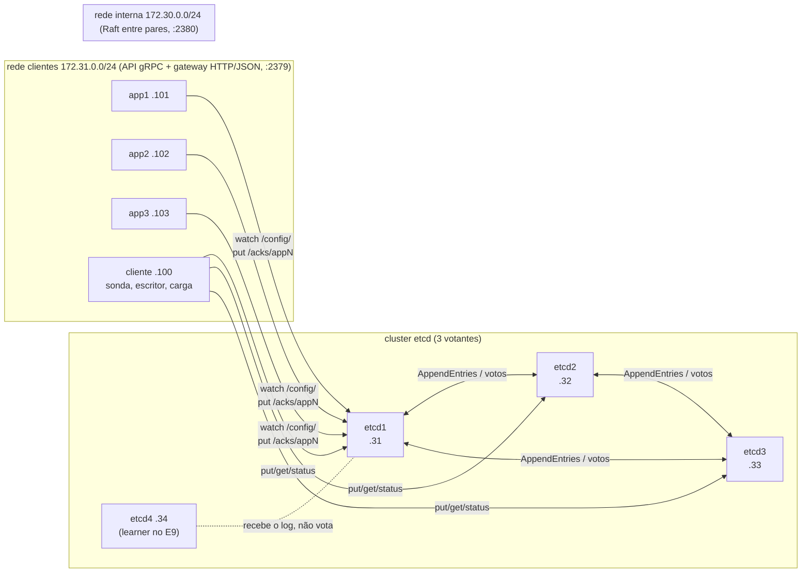
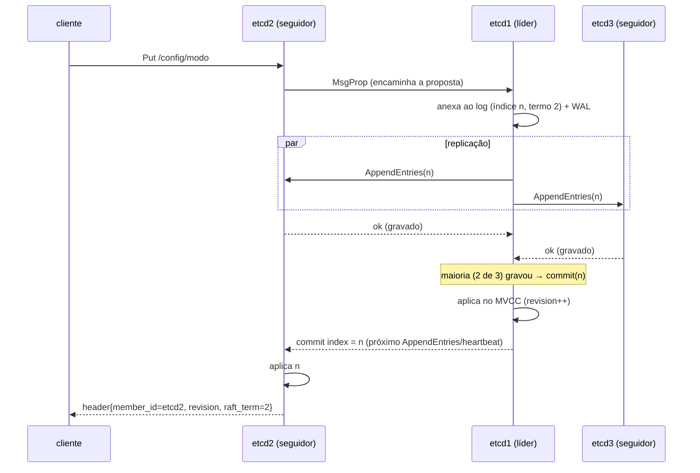

# Replicação de estado e configuração com etcd (Raft)

**Trabalho M2 – Sistemas Distribuídos – Tema 5 – Ênfase C: Configuração dinâmica e membros**

| | |
|---|---|
| **Equipe** | ⟪nome da equipe⟫ |
| **Integrantes** | ⟪Integrante 1⟫ · ⟪Integrante 2⟫ · ⟪Integrante 3⟫ · ⟪Integrante 4⟫ |
| **Tema** | T5 – Replicação de estado / configuração (etcd) |
| **Ênfase** | C – Configuração dinâmica e membros |
| **Repositório** | https://github.com/PedroHss04/Trabalho-M2-Sistemas-Distribuidos |
| **Data** | Outubro de 2026 |

---

## Sumário

1. [Identificação](#1-identificação)
2. [Resumo](#2-resumo)
3. [Fundamentação](#3-fundamentação)
4. [Ambiente e reprodutibilidade](#4-ambiente-e-reprodutibilidade)
5. [Experimentos E1 a E9](#5-experimentos-e1-a-e9)
6. [Questões comuns Q1 a Q14](#6-questões-comuns-q1-a-q14)
7. [Questões específicas S1 a S4](#7-questões-específicas-s1-a-s4)
8. [Quadro-síntese](#8-quadro-síntese)
9. [Limitações e ameaças à validade](#9-limitações-e-ameaças-à-validade)
10. [Papel de cada integrante](#10-papel-de-cada-integrante)
11. [Declaração de uso de IA generativa](#11-declaração-de-uso-de-ia-generativa)
12. [Referências](#12-referências)

---

## 1. Identificação

Equipe ⟪nome⟫, integrantes ⟪nomes e matrículas⟫. Tema 5 (etcd, algoritmo de consenso Raft),
ênfase C: aplicações que reagem a mudanças de configuração via *watch* e reconfiguração do
cluster (learner → promote → remove) sem perda de disponibilidade.

## 2. Resumo

Montamos um cluster etcd v3.5.17 com 3 membros em contêineres Docker, com redes separadas para o
tráfego Raft (2380) e para clientes (2379), três aplicações Python que observam `/config/` via
*watch* e um contêiner cliente com uma sonda de medição própria. Executamos a bateria E1–E8 e o
experimento da ênfase (E9), sempre com scripts reprodutíveis e repetições (≥ 5) para os tempos.
O etcd se comportou como uma **máquina de estados replicada CP**: toda escrita passa pelo líder e
só é confirmada com maioria; a perda da maioria ou o isolamento do líder bloqueiam escritas e
leituras linearizáveis, e só a leitura serializável (pedida explicitamente) devolve dados antigos.
Medimos 1,17 ± 0,16 s sem líder após a queda abrupta do líder e 16 ± 5 ms quando o líder é
desligado de forma graciosa (transferência de liderança). Capturamos dois membros reportando
"líder" ao mesmo tempo durante uma partição, em termos diferentes, sem nenhuma violação de
segurança. Na ênfase C, as três aplicações aplicam uma mudança de configuração em 7,5 ± 2,8 ms e o
*watch* sobrevive à queda do membro e à compactação do histórico; a reconfiguração completa do
cluster (adicionar learner, promover, remover um votante) foi repetida 15 vezes com um escritor
contínuo a cada 50 ms: 10 376 escritas, nenhuma falha. Remover o líder diretamente causou 1–3 s sem
escritas; transferir a liderança antes (`move-leader`) reduziu isso para 92 ms.

## 3. Fundamentação

### 3.1 O sistema e sua origem

O etcd é um armazenamento chave-valor distribuído e fortemente consistente, criado pela CoreOS em
2013 para guardar configuração e coordenar máquinas de um cluster, hoje projeto graduado da CNCF.
É o "cérebro" do Kubernetes: todo o estado do cluster (pods, serviços, *leases* dos controladores)
fica no etcd e é observado pelos componentes via *watch*. Ele guarda pouco dado (o limite padrão é
2 GB), mas dado crítico, e por isso prioriza consistência e tolerância a falhas sobre vazão.

O etcd implementa o **Raft** (ONGARO; OUSTERHOUT, 2014), o artigo seminal do tema: um algoritmo
de consenso equivalente ao Multi-Paxos em garantias, mas decomposto em partes fáceis de entender
(eleição de líder, replicação do log e segurança). O conceito subjacente é a **máquina de estados
replicada**: se todas as réplicas aplicarem o mesmo log de comandos, na mesma ordem, a partir do
mesmo estado inicial, todas chegam ao mesmo estado.

### 3.2 Arquitetura (diagrama próprio)



Cada membro do etcd tem as mesmas camadas:

| Camada | Papel |
|---|---|
| API v3 (gRPC + gateway HTTP/JSON) | recebe `Put`, `Range`, `Txn`, `Watch`, `LeaseGrant`, `MemberAdd`... |
| etcdserver | encaminha propostas ao líder, aplica entradas confirmadas, ReadIndex, leases |
| raft | eleição, replicação do log, commit por maioria, snapshots |
| WAL + snapshot | log de escrita antecipada em disco (durabilidade) e fotografias periódicas |
| MVCC (bbolt) | armazenamento multiversão: cada escrita cria uma nova **revisão** global |

### 3.3 Conceitos necessários para os experimentos

**Papéis e termos do Raft.** Cada membro é *seguidor*, *candidato* ou *líder*. O tempo é dividido
em **termos** numerados; cada termo começa com uma eleição e tem no máximo um líder. O líder envia
*heartbeats* (no etcd, a cada 100 ms); um seguidor que fica sem notícias por um *election timeout*
(1000 ms, com aleatorização) vira candidato, incrementa o termo, vota em si e pede votos. Cada membro
vota uma única vez por termo, e só em candidatos cujo log seja pelo menos tão atualizado quanto o
seu (**restrição de eleição**). Quem recebe a maioria vira líder.

**Replicação e commit.** O cliente envia a escrita a qualquer membro; um seguidor a encaminha ao
líder. O líder anexa a entrada ao seu log, envia `AppendEntries` aos seguidores e considera a
entrada **confirmada (committed)** quando a maioria a gravou. Só então ela é aplicada à máquina de
estados (MVCC) e o cliente recebe a resposta. Entradas confirmadas nunca são desfeitas.

**Pre-vote e check quorum.** Com *pre-vote* (ligado por padrão no etcd 3.5), um membro só
incrementa o termo se uma sondagem prévia indicar que ele venceria: um nó isolado não infla o termo
e não derruba o líder ao voltar. Com *check quorum*, um líder que deixa de ouvir a maioria por um
*election timeout* renuncia sozinho.

**Modelo de dados.** Chave-valor com **MVCC**: cada escrita incrementa a **revisão** global do
cluster (um contador único, monotônico), e versões antigas ficam acessíveis até a **compactação**.
Sobre esse modelo o etcd oferece *watch* (fluxo de eventos a partir de uma revisão), *leases*
(TTL; chaves associadas somem quando o lease expira), e *transações* (`Txn`: if/then/else
atômico sobre revisões e valores, a base de *compare-and-swap*, travas e eleições).

**Leituras.** A leitura padrão é **linearizável**: o membro obtém do líder o índice de commit atual
(**ReadIndex**), o líder confirma com uma rodada de *heartbeats* que ainda é líder, e o membro
espera aplicar até esse índice antes de responder. Nada é gravado no log. A leitura
**serializável** (`--consistency=s`) responde com o dado local, sem consultar ninguém: mais rápida,
disponível mesmo sem quórum, mas possivelmente desatualizada.

**Snapshots, compactação e learners.** O log não cresce para sempre: a cada `snapshot-count`
entradas (padrão 100 000) o etcd grava um snapshot e descarta entradas antigas do log em memória
(mantendo 5 000 para seguidores atrasados). Um membro que ficou para trás além disso recebe o
**snapshot do banco inteiro**. Um **learner** é um membro que recebe o log mas não vota nem conta
para o quórum; serve para um membro novo alcançar o estado sem enfraquecer a disponibilidade, e só
depois ser promovido a votante.

**ZooKeeper (comparação).** O ZooKeeper (HUNT et al., 2010) resolve o mesmo problema com o
protocolo ZAB (JUNQUEIRA; REED; SERAFINI, 2011): líder, *épocas* (análogas aos termos), escrita
confirmada por maioria. Diferenças: leituras do ZooKeeper são locais por padrão (o cliente usa
`sync` para forçar atualização), enquanto no etcd a linearizável é o padrão; o ZooKeeper tem
*znodes efêmeros* (ligados à sessão) e *sequenciais*, com os quais se constroem travas e eleição;
o etcd obtém o mesmo com *leases* e com a revisão de criação das chaves.

## 4. Ambiente e reprodutibilidade

### 4.1 Hardware e software

| Item | Valor |
|---|---|
| Máquina | Notebook, Intel Core i5-1335U (10 núcleos / 12 threads), 15,7 GB RAM, SSD NVMe 512 GB |
| Sistema | Windows 11 Home 10.0.26200 |
| Virtualização | WSL 2 3.0.3 (kernel 6.18.54.1-microsoft-standard-WSL2); VM com 12 CPUs e 7,6 GB |
| Docker | Docker Desktop 4.95.0, Engine 29.8.2, Compose v2 |
| etcd | `quay.io/coreos/etcd:v3.5.17` (etcdctl incluso; imagem sem shell) |
| Python | `python:3.12-alpine` (apps, sonda e scripts; só biblioteca padrão) |
| Shell dos scripts | GNU bash 5.3 (Git Bash); também roda no bash do WSL/Linux |

### 4.2 Topologia, endereços, portas e memória

| Contêiner | Papel | Rede interna (Raft :2380) | Rede clientes (API :2379) | Limite de memória | Uso medido (repouso → pico) |
|---|---|---|---|---|---|
| etcd1 | membro votante | 172.30.0.31 | 172.31.0.31 | 256 MB | 21 MiB → 115 MiB (líder no `check perf`) |
| etcd2 | membro votante | 172.30.0.32 | 172.31.0.32 | 256 MB | 23 MiB → 52 MiB |
| etcd3 | membro votante | 172.30.0.33 | 172.31.0.33 | 256 MB | 24 MiB → 52 MiB |
| etcd4 | learner → votante (E9) | 172.30.0.34 | 172.31.0.34 | 256 MB | – |
| app1..3 | aplicações com *watch* | – | 172.31.0.101–103 | 64 MB | 14–16 MiB |
| cliente | sonda, escritor, carga | – | 172.31.0.100 | 64 MB | 3 MiB |

Os limites são declarados no `docker-compose.yml` (`mem_limit`) e foram respeitados em todos os
experimentos (evidência: `resultados/e1_topologia_*.log` e `e3_replicacao_*.log`). Os membros têm
*healthcheck* (`etcdctl endpoint health`, que exige quórum), e o `reset.sh` usa
`docker compose up --wait` para só começar quando os três estão saudáveis.

### 4.3 Instruções de execução

```bash
git clone https://github.com/PedroHss04/Trabalho-M2-Sistemas-Distribuidos.git
cd Trabalho-M2-Sistemas-Distribuidos
./scripts/reset.sh                 # sobe do zero e espera o cluster ficar saudável
./scripts/e1_topologia.sh          # ... um script por experimento, até:
./scripts/e9_repeticoes.sh 5
```

O README detalha cada script. Cada um grava o log completo em `resultados/` e os tempos em CSV.

### 4.4 Método de medição

No Windows, um `docker exec` custa cerca de 200 ms, mais que alguns dos fenômenos medidos. Por
isso escrevemos a **sonda** (`scripts/sonda.py`), que roda dentro do contêiner `cliente`, consulta
`/v3/maintenance/status` de cada membro em threads independentes a cada ~10 ms e mede tudo com um
único relógio. Exemplo: para medir a eleição, a sonda registra o último instante em que o líder
antigo respondeu e o primeiro instante em que algum membro reporta outro líder com termo maior.
Estatísticas: média e desvio padrão amostral (n − 1).

## 5. Experimentos E1 a E9

### E1 – Subida e topologia

**Objetivo.** Cluster com 3 membros no ar e papéis identificados.
**Previsão.** Três membros `started`, um líder eleito no termo 2 (o termo 1 é o de inicialização)
e o mesmo índice do Raft nos três.
**Procedimento.** `./scripts/reset.sh` e `./scripts/e1_topologia.sh`.
**Evidência** (`resultados/e1_topologia_*.log`):

```
| ID               | STATUS  | NAME  | PEER ADDRS              | CLIENT ADDRS            | IS LEARNER |
| 729febf16625624c | started | etcd2 | http://172.30.0.32:2380 | http://172.31.0.32:2379 |      false |
| a740cd75718ef0d5 | started | etcd3 | http://172.30.0.33:2380 | http://172.31.0.33:2379 |      false |
| f7c63021767e3289 | started | etcd1 | http://172.30.0.31:2380 | http://172.31.0.31:2379 |      false |

| ENDPOINT                | IS LEADER | RAFT TERM | RAFT INDEX | RAFT APPLIED INDEX |
| http://172.31.0.31:2379 |      true |         2 |         22 |                 22 |
| http://172.31.0.32:2379 |     false |         2 |         22 |                 22 |
| http://172.31.0.33:2379 |     false |         2 |         22 |                 22 |
endpoint health: true nos três (1,5–2,4 ms)
```

**Análise.** Confirmado: etcd1 venceu a primeira eleição (termo 2), os três têm o mesmo índice e
o mesmo índice aplicado. O diagrama da seção 3.2 mostra membros, redes, portas e o líder inicial.
Em repouso cada membro usa ~22 MiB dos 256 MiB permitidos.

### E2 – Caminho de uma operação

**Objetivo.** Mostrar quem recebe, quem decide, quem replica e quem responde.
**Previsão.** Um `put` enviado a um seguidor é aceito (o seguidor encaminha ao líder); a resposta
traz o termo do líder; o índice do Raft avança nos três; o put via seguidor é um pouco mais lento
que direto no líder (um salto a mais).
**Procedimento.** `./scripts/e2_caminho.sh`: `put` com endpoint único no seguidor etcd2 e
`-w json`; `endpoint status` antes e depois; 100 puts direto no líder x 100 via seguidor.
**Evidência** (`resultados/e2_caminho_*.log`, `e2_caminho_*.csv`):

```
antes:  RAFT INDEX 188 / 188 / 188   (etcd1 líder, termo 2)
put em etcd2 -w json:
{"header":{"cluster_id":6775757553465404157,"member_id":8259579663654150732,"revision":10,"raft_term":2}}
depois: RAFT INDEX 194 / 194 / 194
put direto no líder etcd1: n=100  média=3,58 ms  desvio=1,06
put via seguidor etcd2:    n=100  média=4,30 ms  desvio=1,46
```



**Análise.** O `member_id` da resposta é o do etcd2, mas o `raft_term` é o termo do líder: o
seguidor não decide nada, apenas encaminha e devolve o resultado depois de aplicar a entrada
confirmada. O índice avançou de 188 para 194 nos três membros, ou seja, a entrada (e as escritas
que as três aplicações fizeram em `/acks/` ao reagir à mudança via *watch*) foi replicada e
aplicada em todos. O custo do salto extra seguidor → líder foi de **0,72 ms** em média, coerente
com uma ida e volta na rede virtual local.

### E3 – Replicação

**Objetivo.** Escrever em um membro, ler em outro, ver a notificação de *watch* num terceiro e
medir o tempo de propagação.
**Previsão.** O valor aparece nos três; a propagação para os seguidores leva poucos milissegundos,
um pouco mais que a latência do próprio put (o seguidor só aplica depois de saber do commit).
**Procedimento.** `./scripts/e3_replicacao.sh`: *watch* num contêiner avulso apontando só para o
etcd3, `put` no etcd1, `get` no etcd2. Depois, 20 repetições de: `put` no líder enquanto threads
leem (serializável, dado local) cada seguidor até ver o valor novo. Por fim `check perf --load=s`.
**Evidência** (`resultados/e3_replicacao_*.log`, `e3_propagacao_*.csv`):

```
>> get no etcd2:  /e3/x = escrito-no-etcd1-22:09:57
>> watch no etcd3: {"Header":{"member_id":12051858507143508181,"revision":214,"raft_term":2},
                    "Events":[{"kv":{"key":"L2UzL3g=","mod_revision":214,...}}]}
```

| Medida (n = 20) | Média (ms) | Desvio (ms) | Mín | Máx |
|---|---|---|---|---|
| Latência do `put` no líder | 6,67 | 1,57 | 4,80 | 9,60 |
| Valor visível no seguidor etcd2 | 7,92 | 1,54 | 5,80 | 10,80 |
| Valor visível no seguidor etcd3 | 7,84 | 1,64 | 5,50 | 10,90 |

`check perf --load=s`: **PASS** – vazão de 151 escritas/s, requisição mais lenta 82,6 ms, desvio
3,5 ms. Memória durante a carga: líder 114,8 MiB, seguidores 52 MiB (limite 256 MiB).

**Análise.** A notificação chegou ao *watch* do etcd3 com a mesma revisão (214) da escrita feita no
etcd1: os eventos são entregues em ordem de revisão em qualquer membro. O seguidor passa a ter o
valor ~1,2 ms depois de o líder responder ao cliente, porque o líder responde assim que a maioria
gravou, e o seguidor só aplica quando recebe o novo índice de commit no `AppendEntries` seguinte.
Essa janela é o motivo de a leitura serializável num seguidor poder ser desatualizada (E4). O
`check perf` passou com folga; o líder usa mais memória porque mantém o estado de replicação de
cada seguidor e as filas de propostas.

### E4 – Consistência

**Objetivo.** Evidenciar o modelo de consistência: linearizável (padrão) x serializável.
**Previsão.** Em condições normais as duas devolvem o mesmo valor, com a linearizável mais lenta
(rodada de confirmação com o líder). Com um seguidor isolado, a serializável devolve o valor antigo
e a linearizável falha.
**Procedimento.** `./scripts/e4_consistencia.sh`: 200 leituras alternadas de cada tipo num
seguidor e no líder; depois o seguidor etcd3 é desconectado da rede interna, um valor novo é
escrito pela maioria e lido no isolado com as duas consistências.
**Evidência** (`resultados/e4_consistencia_*.log`, `e4_leituras_*.csv`):

| Leitura (n = 200) | Seguidor etcd3: média ± desvio (ms) | Líder etcd1: média ± desvio (ms) |
|---|---|---|
| Linearizável | 1,30 ± 0,29 | 1,07 ± 0,39 |
| Serializável | 0,81 ± 0,32 | 0,82 ± 0,40 |

Sequência temporal com etcd3 isolado:

```
22:12:17.492 etcd3 lê (serializável): ANTIGO
22:12:17.897 etcd3 desconectado da rede interna
22:12:20.941 put /e4/valor=NOVO pela maioria (etcd1): OK
22:12:21.138 etcd1 lê (linearizável): NOVO
22:12:21.343 etcd3 lê (serializável):  ANTIGO                       <- dado desatualizado
22:12:21.549 etcd3 lê (linearizável):  Error: context deadline exceeded
22:12:24.761 etcd3 tenta escrever:     Error: context deadline exceeded
status do etcd3: IS LEADER false, RAFT TERM 2, ERRORS "etcdserver: no leader"
(reconexão) etcd3 alcançou o líder 261 ms após reingressar; lê NOVO nas duas consistências
```

**Análise.** Previsão confirmada. A linearizável custa ~0,5 ms a mais no seguidor (ReadIndex:
pergunta ao líder, que confirma a liderança com *heartbeats*) e ~0,25 ms a mais no próprio líder
(só a confirmação de liderança). Isolado, o seguidor não consegue confirmar o índice de commit com
o líder e recusa a leitura linearizável e a escrita; a serializável responde do estado local,
**ANTIGO**: é exatamente a janela de leitura desatualizada que o cliente aceita ao pedir
`--consistency=s`. Observação adicional: o termo do etcd3 isolado continuou **2**: graças ao
*pre-vote*, ele não incrementou o termo enquanto não podia vencer, e ao voltar não forçou uma
eleição desnecessária (o líder continuou o mesmo).

### E5 – Falha e quórum

**Objetivo.** Derrubar o líder (minoria) e depois dois membros (maioria); medir o tempo de eleição.
**Previsão.** Com 1 membro a menos o cluster continua (maioria 2 de 3), com uma janela sem líder
de ~1–2 s (election timeout de 1 s + aleatorização). Com 2 a menos, escrita e leitura linearizável
falham; a serializável ainda responde.
**Procedimento.** `./scripts/e5_falha.sh`: 5 vezes `docker kill` no líder (queda abrupta, SIGKILL)
e 5 vezes `docker stop` (SIGTERM, desligamento gracioso), medindo com a sonda; depois o quadro de
operações com 3, 2 e 1 membros ativos (endpoint único do sobrevivente, timeout 3 s).
**Evidência** (`resultados/e5_falha_*.log`, `e5_eleicao.csv`):

| Rep. | `kill`: líder → novo (termo) | sem líder (ms) | `stop`: líder → novo (termo) | sem líder (ms) |
|---|---|---|---|---|
| 1 | etcd1 → etcd3 (2→3) | 1370,2 | etcd1 → etcd3 (7→8) | 23,3 |
| 2 | etcd3 → etcd2 (3→4) | 1111,2 | etcd3 → etcd2 (8→9) | 12,6 |
| 3 | etcd2 → etcd1 (4→5) | 996,0 | etcd2 → etcd1 (9→10) | 10,7 |
| 4 | etcd1 → etcd2 (5→6) | 1052,3 | etcd1 → etcd3 (10→11) | 13,6 |
| 5 | etcd2 → etcd1 (6→7) | 1311,5 | etcd3 → etcd2 (11→12) | 17,7 |
| **média ± desvio** | | **1168,2 ± 164,1** | | **15,6 ± 5,0** |

| Membros ativos | Escrita | Leitura linearizável | Leitura serializável |
|---|---|---|---|
| 3 de 3 | OK | OK | OK |
| 2 de 3 (etcd1 parado) | OK | OK | OK |
| 1 de 3 (etcd1 e etcd3 parados) | FALHA (`context deadline exceeded`) | FALHA (`context deadline exceeded`) | OK (valor local) |

**Análise.** Com a queda abrupta, os seguidores só percebem a falta do líder depois do *election
timeout* (1000 ms) somado à aleatorização; a janela medida (1,0–1,4 s) é coerente com isso. Cada
eleição incrementou o termo exatamente em 1, sem eleições divididas. O resultado inesperado para a
equipe foi o `docker stop`: ~16 ms sem líder. Ao receber SIGTERM, o etcd líder **transfere a
liderança** (`MsgTimeoutNow`) a um seguidor atualizado antes de sair, que inicia a eleição na hora,
sem esperar timeout. Por isso usamos `docker kill` para simular falhas reais. Com 1 de 3 membros
não há maioria (2), o sobrevivente fica sem líder (`etcdserver: no leader`) e só atende leitura
serializável: f = 1 falha tolerada com N = 3.

### E6 – Partição de rede

**Objetivo.** Isolar o líder da rede interna, mantendo-o acessível aos clientes, e observar os dois
lados.
**Previsão.** A maioria (2) elege um novo líder com termo maior; o antigo líder, sem maioria, para
de aceitar escritas (renuncia por *check quorum*); um cliente ligado só a ele recebe erro.
**Procedimento.** `./scripts/e6_particao.sh`.
**Evidência** (`resultados/e6_particao_*.log`):

```
22:15:18.183 docker network disconnect t5-etcd-enfasec_interna etcd2   (etcd2 era o líder, termo 13)
22:15:19.585 sonda: novo líder etcd1, termo 14 (≈1,1 s após o início da observação)

Logo após a eleição — DOIS membros dizem ser líder, em termos diferentes:
| http://172.31.0.31:2379 | IS LEADER true  | RAFT TERM 14 | RAFT INDEX 9880 |
| http://172.31.0.32:2379 | IS LEADER true  | RAFT TERM 13 | RAFT INDEX 9878 |   <- isolado
| http://172.31.0.33:2379 | IS LEADER false | RAFT TERM 14 | RAFT INDEX 9880 |
3 s depois: etcd2 IS LEADER false, termo 13, ERRORS "etcdserver: no leader"

Lado majoritário:  put via etcd1 OK;  get linearizável = DEPOIS-DA-PARTICAO
Lado minoritário:  put em etcd2             -> Error: context deadline exceeded
                   get linearizável em etcd2 -> Error: context deadline exceeded
                   get serializável em etcd2 -> ANTES-DA-PARTICAO
Reconexão: etcd2 volta como seguidor no termo 14, mesmo índice (9895) dos outros dois.
```

**Análise.** O momento mais instrutivo do trabalho: por um instante há **dois "líderes"**. Isso
não viola a segurança do Raft, porque o líder do termo 13 não consegue confirmar nada sem maioria;
seu índice parou em 9878 enquanto o do termo 14 seguiu. Em ~1 s (o *election timeout*) o *check
quorum* fez o líder isolado renunciar. Para o cliente preso ao lado minoritário o sistema fica
**indisponível** para escrita e para leitura linearizável: o etcd escolhe **consistência** (CP no
teorema CAP). Pela extensão PACELC, também na ausência de partição ele escolhe consistência em
detrimento da latência (PC/EC): toda escrita espera a maioria e a leitura padrão paga o ReadIndex
(E4). A única "fuga" é a leitura serializável, pedida explicitamente pelo cliente.

### E7 – Recuperação

**Objetivo.** Mostrar o membro que volta se atualizando e medir o tempo; comparar recuperação por
log e por snapshot.
**Previsão.** O líder isolado volta como seguidor com o termo novo e recebe as entradas que perdeu
via `AppendEntries`; com `snapshot-count` baixo e muitas escritas, o líder já descartou essas
entradas e envia um snapshot do banco.
**Procedimento.** `./scripts/e7_recuperacao.sh`. Parte 1 (5×): isolar o líder, gravar 1000 chaves
pela maioria, reconectar e medir com a sonda. Parte 2: parar um seguidor, gravar 12 000 chaves e
religá-lo, com `SNAPSHOT_COUNT=1000` e com o padrão (100 000), comparando os logs.
**Evidência** (`resultados/e7_recuperacao_*.log`, `e7_recuperacao.csv`):

| Rep. | Membro que volta | Entradas atrás | Catch-up após reingresso (ms) |
|---|---|---|---|
| 1 | etcd1 | 1008 | 23,4 |
| 2 | etcd2 | 1007 | 73,8 |
| 3 | etcd1 | 1008 | 23,1 |
| 4 | etcd3 | 1009 | 61,9 |
| 5 | etcd2 | 1008 | 61,1 |
| **média ± desvio** | | | **48,7 ± 23,7** |

Estado final idêntico: `endpoint hashkv` = **1810685005** nos três membros.

Parte 2 — linha do tempo do membro que voltou (carimbos do próprio log do etcd):

```
SNAPSHOT_COUNT=1000                               SNAPSHOT_COUNT=100000 (padrão)
   +0 ms  starting an etcd server                    +0 ms  starting an etcd server
  +33 ms  receiving database snapshot              +236 ms  published local member to cluster
 +133 ms  applied snapshot                         +236 ms  ready to serve client requests
 +135 ms  ready to serve client requests
líder: 12x "triggering snapshot", "sending database snapshot", "sent database snapshot"
seguidor: "restored snapshot [index: 12047, term: 2]", "applied incoming Raft snapshot"
```

**Análise.** O membro reconectado adotou o termo novo e recebeu ~1000 entradas em 49 ± 24 ms. Com
`snapshot-count=1000`, o líder tinha descartado as entradas antigas do log e enviou o **banco
inteiro** (~11 MB), que o seguidor carregou de uma vez (`restored snapshot [index: 12047]`); sem
snapshot, recebeu e reaplicou as 12 000 entradas. Neste ambiente o snapshot foi mais rápido
(135 x 236 ms) porque a rede é local e o banco é pequeno; com um banco grande e muitos membros
atrasados o custo se inverte, e por isso o padrão é snapshot raro. É a ponte com **estado global e
snapshots** (Chandy-Lamport): em vez de reconstruir o estado pela história completa, transfere-se
uma fotografia consistente (um prefixo do log já aplicado, identificado por índice e termo) e só
o que vem depois.

### E8 – Coordenação e ordem

**Objetivo.** Mostrar quem coordena e o mecanismo de ordenação; usar o etcd para exclusão mútua e
eleição de líder de aplicações.
**Previsão.** A revisão cresce de um em um a cada escrita, independentemente de trocas de líder; o
termo só muda numa eleição. O `lock` garante um detentor por vez; ao matar o detentor, o outro só
assume quando o *lease* expira (TTL 10 s no `lock`).
**Procedimento.** `./scripts/e8_coordenacao.sh`. Os clientes de `lock` e `elect` rodam em
contêineres descartáveis (`docker run ... etcdctl`), para que "matar o detentor" não derrube um
membro do cluster. `docker kill` simula uma queda (o cliente não libera nada); `docker stop`
(SIGTERM) deixa o etcdctl sair de forma limpa.
**Evidência** (`resultados/e8_coordenacao_*.log`, `e8_failover.csv`):

```
escrita-1: revision=12012  raft_term=3
escrita-2: revision=12013  raft_term=3
>> derrubando o líder etcd1 (docker kill); novo líder etcd2
escrita-3: revision=12014  raft_term=4
escrita-4: revision=12015  raft_term=4
get /e8/relogio (atual, mod_revision=12015): escrita-4
get /e8/relogio --rev=12014:                 escrita-3        <- MVCC: o passado continua legível

lock: A detém trava/3289a13d272d6707; B espera (não imprime nada)
   trava/3289a13d272d6707  create_revision=12016  lease=3641619057728120583   <- A
   trava/70d5a13d2694b52f  create_revision=12017  lease=8130581986299655471   <- B (fila)
```

| Recurso / modo | n | Espera até o outro assumir: média ± desvio (s) | mín – máx |
|---|---|---|---|
| `lock --ttl=10`, `kill` no detentor | 5 | 8,46 ± 1,18 | 7,43 – 10,13 |
| `lock --ttl=10`, `stop` no detentor | 1 | 0,50 | – |
| `elect` (TTL padrão 60 s), `kill` | 5 | 49,57 ± 8,65 | 41,58 – 60,04 |
| `elect`, `stop` | 1 | 0,48 | – |

**Análise.**
*Ordem.* Termo e revisão são relógios lógicos com papéis diferentes. O **termo** é uma época de
liderança (3 → 4 quando etcd1 caiu) e serve para descartar mensagens de líderes antigos. A
**revisão** é um contador global que dá **ordem total** às escritas (12012, 12013, 12014, 12015,
sem lacunas nem repetições, atravessando a troca de líder) e versiona os dados (MVCC). Como no
relógio de Lamport, a ordem vem de um contador e não do relógio físico; aqui, porém, um único
coordenador (o líder) atribui os números, então a ordem é total sem precisar de desempate por id.
*Exclusão mútua.* Cada cliente cria uma chave `trava/<lease>` com seu lease; quem tem a menor
`create_revision` detém a trava, e os demais observam (via *watch*) apenas a chave imediatamente
anterior, formando uma **fila justa** sem "efeito manada". Ao matar o detentor, a chave só some
quando o lease expira. A espera medida (7,4–10,1 s) fica abaixo do TTL de 10 s porque o cliente
renova o lease a cada ~TTL/3: a espera é o tempo **restante** do lease no instante da queda, que
fica entre ⅔·TTL e TTL, ou seja, entre 6,7 e 10 s (previsão confirmada nas 5 repetições).
Com `stop`, o etcdctl revoga o lease ao sair e o outro assume em 0,5 s.
*Eleição.* `etcdctl elect` usa o mesmo mecanismo com uma sessão de **TTL padrão 60 s** (o comando
não oferece `--ttl`); por isso o failover medido foi de 41,6 a 60,0 s (de novo entre ⅔·TTL = 40 s e
TTL = 60 s), e não os ~11 s citados no roteiro, que correspondem ao TTL de 10 s do `lock`. O
observador (`elect -l`) registrou a alternância candidatoA → candidatoB em todas as 12 trocas, sem
nunca mostrar dois líderes da aplicação ao mesmo tempo. Em produção, o TTL da sessão é o compromisso
entre detectar falhas rápido e não destituir um líder por uma pausa curta.
*Raft x Bully x Anel* (resposta completa em S1). No Bully, vence o maior identificador vivo, com
O(n²) mensagens no pior caso, e um nó lento mas vivo pode ser declarado morto, gerando dois
coordenadores. No Anel, a mensagem de eleição circula pelo anel coletando ids, com O(n) mensagens
por volta, e a eleição depende de o anel estar íntegro. Ambos supõem detecção de falhas confiável.
O Raft não supõe isso: usa termos e voto único por termo para garantir no máximo um líder por
termo, escolhe o candidato com o log mais atualizado (não o maior id) e exige maioria, de modo que
uma partição minoritária nunca elege líder.

### E9 – Ênfase C: configuração dinâmica e membros

#### E9.1 – Aplicações que reagem a mudanças de configuração via *watch*

**Objetivo.** Três aplicações observam `/config/`; ao mudar a configuração, todas aplicam a nova,
sem *polling*, e continuam corretas diante de falhas.
**Projeto da aplicação** (`app/app_watch.py`, `app/etcdhttp.py`):
1. Ao iniciar, lê todo o prefixo `/config/` com um `get` e guarda a revisão R da resposta
   (fotografia consistente do estado).
2. Abre um *watch* a partir de **R + 1**: nenhuma mudança entre a leitura e o watch se perde.
3. A cada evento, aplica a configuração, guarda a revisão vista e grava um ACK em `/acks/<app>`.
4. Se a conexão cair, reconecta em **outro membro** e retoma de `última revisão + 1`. Os *progress
   notify* (a cada 5 s) avançam a revisão mesmo sem eventos e ajudam a detectar conexão morta.
5. Se a revisão pedida já foi **compactada**, o servidor cancela o watch; o app relê o estado
   inteiro (novo `get`) e volta ao passo 2. Esse tratamento foi acrescentado neste trabalho.

**Previsão.** Atraso de poucos milissegundos (um commit + a entrega do evento); na queda do membro
em que as apps estão conectadas, as apps reconectam em outro e aplicam **todas** as mudanças feitas
no intervalo, em ordem.
**Procedimento.** `./scripts/e9_watch.sh` (20 repetições de medição, queda do membro e compactação).
**Evidência** (`resultados/e9_watch_*.log`, `watch_*.csv`):

| Atraso put → app aplicou (n = 20) | Média (ms) | Desvio (ms) | Mín | Máx |
|---|---|---|---|---|
| app1 | 7,53 | 2,79 | 4,02 | 14,66 |
| app2 | 7,56 | 2,79 | 4,04 | 14,69 |
| app3 | 7,53 | 2,83 | 3,96 | 14,82 |

Queda do etcd1, em que as três apps tinham o *watch* aberto (trecho do log):

```
01:35:30 [app1] watch caiu em http://172.31.0.31:2379 (conexão encerrada pelo servidor); reconectando e retomando da revisão 87
01:35:31 [app1] watch aberto em http://172.31.0.32:2379 a partir da revisão 87
01:35:32 [app1] rev=90 APLICADA /config/modo = durante-a-queda-a
01:35:32 [app1] rev=94 APLICADA /config/modo = durante-a-queda-b
01:35:32 [app1] rev=98 APLICADA /config/modo = durante-a-queda-c
(idem app2 e app3)
```

Compactação com o app1 fora da rede por 20 s (5 mudanças + `compact 117` nesse intervalo):

```
01:35:56 [app1] watch caiu em http://172.31.0.32:2379 (timed out); reconectando e retomando da revisão 102
01:35:57 [app1] watch caiu em http://172.31.0.33:2379 (Network unreachable) ... (backoff 0,5 s → 2 s)
01:36:04 [app1] watch aberto em http://172.31.0.33:2379 a partir da revisão 102
01:36:04 [app1] watch cancelado (revisão compactada até 117); estado relido na revisão 119:
         {'/config/log_level': 'info', '/config/modo': 'pos-compactacao', '/config/versao': '5'}
01:36:04 [app1] watch aberto em http://172.31.0.33:2379 a partir da revisão 120
```

**Análise.** As três aplicações aplicam a nova configuração em 7,5 ± 2,8 ms após o
`put`, praticamente ao mesmo tempo (diferença entre apps < 0,1 ms, porque o mesmo evento é
enviado aos três fluxos de *watch* no momento em que a revisão é aplicada). Não há *polling*: o
custo é um commit Raft mais a entrega do evento. A medição usa o relógio comum da VM (seção 9).

Na queda do membro, as apps perceberam o fim da conexão (o etcd fecha os fluxos ao desligar),
reconectaram em outro membro em ~1 s e **retomaram da revisão 87**, recebendo as revisões 90, 94 e
98 em ordem, sem perder nem repetir nada. Isso só é possível porque o *watch* do etcd é ancorado
numa **revisão** (relógio lógico global, Q9), e não num instante de tempo ou numa conexão: qualquer
membro consegue reproduzir o histórico a partir de qualquer revisão ainda não compactada. (A
revisão avança de 4 em 4 porque cada mudança de configuração gera também os 3 ACKs das apps.)

A compactação mostra o limite desse mecanismo: o histórico anterior à revisão 117 foi descartado,
e o app1 pediu a revisão 102. O etcd cancelou o *watch* (`compact_revision = 117`), e o app, em
vez de ficar em laço tentando (comportamento da versão original do kit, corrigido neste trabalho),
**releu o estado completo** (`get` do prefixo, revisão 119) e reabriu o *watch* em 120. É a mesma
ideia da recuperação por snapshot do E7: quando o log não existe mais, transfere-se o estado. As
mudanças intermediárias (`/config/versao` 1→4) não foram vistas pelo app1, só o valor final, o que
é aceitável para configuração (importa o estado atual), mas não seria para um fluxo de eventos.
O *backoff* exponencial (0,5 s → 5 s) evita que um cliente desconectado inunde a rede e o log.

#### E9.2 – Reconfiguração do cluster sem perda de disponibilidade

**Objetivo.** Adicionar um 4º membro como learner, promovê-lo e remover outro, sem que os clientes
percebam indisponibilidade.
**Previsão.** `member add --learner` não muda o quórum (3 votantes, maioria 2); o learner alcança o
líder em poucos segundos (banco de ~5 MB), recusa leitura linearizável e aceita a serializável; o
`promote` só é aceito quando o learner está sincronizado; com 4 votantes a maioria passa a 3
(continua tolerando só 1 falha); o `remove` volta a 3 votantes. Um escritor a cada 50 ms não deve
registrar falhas, apenas um aumento pontual de latência.
**Procedimento.** `./scripts/e9_repeticoes.sh 5`: em cada rodada, `reset`, 5000 chaves de carga,
escritor contínuo (`escritor.py`, put a cada 50 ms, timeout 1 s) e `e9_reconfig.sh` automático.
Mais 5 rodadas com `REMOVER=lider` (remove o **líder**) e 5 com `REMOVER=lider MOVER_LIDER=1`
(transfere a liderança com `etcdctl move-leader` antes de remover).
**Evidência** (`resultados/reconfig_*.log`, `e9_reconfig_tempos.csv`, `e9_disponibilidade.csv`):

Tempos das operações de reconfiguração (todas as 15 rodadas):

| Etapa (n = 15) | Média | Desvio | Mín | Máx |
|---|---|---|---|---|
| `member add --learner` | 0,227 s | 0,012 | 0,209 | 0,249 |
| Subida do etcd4 (comando → learner respondendo) | 0,911 s | 0,034 | 0,840 | 0,961 |
| Boot + catch-up interno do learner (log do etcd4) | 134,5 ms | 14,9 | 97 | 148 |
| `member promote` | 0,228 s | 0,013 | 0,213 | 0,258 |
| `member remove` | 0,245 s | 0,015 | 0,227 | 0,275 |
| `move-leader` (cenário 3) | 0,355 s | 0,005 | 0,349 | 0,362 |

Os tempos de `add`, `promote`, `remove` e `move-leader` foram medidos no host e incluem ~0,2 s de
`docker exec` (seção 4.4); a operação em si é uma única entrada de configuração no log do Raft.

Disponibilidade vista pelo escritor contínuo (put a cada 50 ms, timeout 1 s, failover entre membros):

| Cenário (5 rodadas cada) | Escritas | Falhas | Maior intervalo sem escrita OK (ms) |
|---|---|---|---|
| 1. Remover um seguidor (etcd3) | 3 494 | 0 | 128 ± 64 (90–224)¹ |
| 2. Remover o **líder** | 3 362 | 0 | **1 869 ± 849** (1 056–3 086) |
| 3. `move-leader` para o etcd4 e depois remover o antigo líder | 3 520 | 0 | **92 ± 4** (87–98) |

¹ Em uma das 5 rodadas do cenário 1 o etcd3 era, por acaso, o líder no momento da remoção, e o
maior intervalo foi de 3 067 ms; a média acima usa as 4 rodadas em que ele era seguidor. Essa
rodada funciona como controle: confirma que o que importa é remover o **líder**, não o etcd3.
Somando os três cenários: **10 376 escritas, 0 falhas.**

```
>> O learner NÃO atende leitura linearizável:  Error: etcdserver: rpc not supported for learner
>> ...mas atende leitura serializável:         {"valor": "producao"}
```

**Análise.** *Learner.* O `member add --learner` não alterou o quórum (3 votantes, maioria 2), e o
etcd4 alcançou o líder em ~135 ms de boot + catch-up (banco de ~5 MB, entradas enviadas pelo log).
Nas 15 rodadas ele recusou a leitura linearizável (`rpc not supported for learner`: sem voto, não
participa do ReadIndex) e respondeu a serializável com o dado local. O `promote` foi aceito na
primeira tentativa porque o learner já estava sincronizado; o etcd recusaria a promoção de um
learner atrasado.

*Quórum durante a reconfiguração.* Entre o `promote` e o `remove`, o cluster teve **4 votantes e
maioria 3**: tolerava a mesma única falha que com 3 membros (S2). Por isso a janela com 4 membros
deve ser curta, e por isso a ordem "adicionar, promover, depois remover" é preferível a "remover,
depois adicionar" (que passaria por 2 membros, sem tolerar nenhuma falha).

*Disponibilidade.* Nenhuma escrita falhou nos três cenários, mas "sem falhas" não quer dizer "sem
interrupção". Remover um **seguidor** é imperceptível (maior intervalo ~0,1 s, próximo do intervalo
nominal de 50 ms). Remover o **líder** deixou o escritor 1 a 3 s sem conseguir escrever: no etcd
3.5, o líder que se remove apenas aplica a mudança e sai, sem transferir a liderança, e os
restantes esperam o *election timeout* (~1 s, E5). Os intervalos aparecem em degraus de ~1 s
(1 056, 2 066, 3 086 ms) porque o cliente usa timeout de 1 s por tentativa: cada tentativa num
membro ainda sem líder custa 1 s antes do *failover*. A indisponibilidade **do cluster** é ~1 s; o
que o cliente sente depende da sua política de timeout.
Com **`move-leader` antes do `remove`**, o líder escolhe o sucessor (o etcd4, recém-promovido e
sincronizado) e o manda iniciar a eleição imediatamente (`MsgTimeoutNow`), como no `docker stop`
do E5. O maior intervalo caiu para **92 ± 4 ms**, o mesmo nível de remover um seguidor. Conclusão
da ênfase: o etcd permite reconfigurar o cluster sem perder disponibilidade, **desde que** o
operador use learner para o membro novo e transfira a liderança antes de remover o líder.

## 6. Questões comuns Q1 a Q14

**Q1 – Problema e transparências.** O etcd resolve o problema de manter um **estado pequeno e
crítico** (configuração, descoberta de serviços, travas, eleição) **consistente e disponível**
apesar de falhas de máquinas, oferecendo um único "registro" lógico a partir de várias réplicas.
Transparências: de **acesso** (a mesma API em qualquer membro, E2); de **localização** (qualquer
membro recebe a requisição e encaminha ao líder; o cliente nem sabe quem é o líder, E2); de
**replicação** (o cliente vê um único valor, não três cópias, E3/E4); de **falha** (o cliente com a
lista de endpoints troca de membro sozinho; até f = 1 falha o serviço continua, E5); de
**concorrência** (escritas concorrentes são serializadas pelo log; travas e transações, E8).
Não há transparência de desempenho: uma partição torna o lado minoritário indisponível (E6).

**Q2 – Arquitetura.** Estilo **cliente-servidor** para os clientes e **centrado em dados** para as
aplicações (elas se coordenam através do etcd, como num repositório compartilhado, e reagem a
eventos via *watch*: estilo **orientado a eventos**, E9). Internamente, uma **máquina de estados
replicada** com **líder** e seguidores, cada membro organizado **em camadas** (API → etcdserver →
raft → WAL/MVCC). Diagrama próprio na seção 3.2; papéis observados no E1.

**Q3 – Localização.** Não há particionamento: **todo membro tem todos os dados**. O cliente
conhece uma lista estática de endpoints (configuração, como nas apps); qualquer membro atende e,
para escritas, encaminha ao líder, cuja identidade cada membro conhece via Raft (E2). Dentro do
membro, a chave é localizada num índice em árvore B (*keyIndex* → revisões → bbolt). Não há hash
nem DHT: a resolução é por **diretório central replicado**.

**Q4 – Comunicação.** Clientes: **gRPC** sobre HTTP/2 com Protocol Buffers (usamos também o
gateway HTTP/JSON, com chaves em base64), **síncrono** (requisição-resposta), exceto o *watch*, um
fluxo assíncrono do servidor para o cliente. Entre pares: mensagens Raft (`AppendEntries`,
`RequestVote`, heartbeats, snapshots) sobre HTTP na porta 2380, comunicação **direta** e
assíncrona por fluxos. Semântica: o Raft entrega cada entrada confirmada **exatamente uma vez** à
máquina de estados de cada membro (o índice do log deduplica). Para o cliente, uma escrita que
deu *timeout* pode ou não ter sido aplicada (**ao menos uma vez** se o cliente reenviar); a
idempotência exige transações condicionais (`Txn` com comparação de revisão).

**Q5 – Replicação.** **Máquina de estados replicada** por consenso, com um **líder** que é o único
a aceitar escritas (seguidores encaminham, E2). N = 3 réplicas completas (5 é o outro tamanho
recomendado); *learners* são réplicas extras que não votam (E9).

**Q6 – Consistência.** Escritas e leituras padrão são **linearizáveis**: toda leitura vê a última
escrita confirmada em tempo real, em qualquer membro (E4: após o `put` NOVO, a linearizável devolve
NOVO em qualquer membro conectado à maioria). Leituras `--consistency=s` são **serializáveis**:
veem um prefixo consistente do log, possivelmente atrasado (E4: o seguidor isolado devolveu
ANTIGO). O *watch* entrega eventos em ordem de revisão sem lacunas (E3, E9).

**Q7 – Quórum.** Sim: maioria ⌊N/2⌋ + 1. Com N = 3, W = 2 (commit) e R = 2 na leitura
linearizável (o ReadIndex exige que o líder confirme a liderança com a maioria), então
R + W = 4 > N = 3: toda leitura intersecta a última escrita. Tolera f = ⌊(N−1)/2⌋ = 1 falha com 3
membros (2 com 5). Demonstração (E5): com 2 de 3 tudo funciona; com 1 de 3 escrita e leitura
linearizável falham com `context deadline exceeded`. A leitura serializável é R = 1 e, por isso,
não tem a garantia.

**Q8 – Líder.** Sim, escolhido **dinamicamente pelo Raft**: timeout aleatório, voto único por termo,
maioria e restrição de log (E5: 10 eleições, termo +1 em cada uma). Comparação com Bully e Anel no
E8 e em S1: o Raft não supõe detector de falhas perfeito nem escolhe pelo maior id, e uma minoria
nunca elege líder (E6).

**Q9 – Ordenação.** **Índice do log** (posição de cada comando), **termo** (época de liderança) e
**revisão** (contador global de escritas do MVCC). O termo funciona como um relógio de Lamport
para líderes: mensagens com termo menor são descartadas, e quem vê termo maior se atualiza (E6:
o antigo líder do termo 13 virou seguidor no 14 ao voltar). A revisão impõe **ordem total**
(E8: 12012 → 12015 atravessando a troca de líder). Isso equivale a um **multicast totalmente
ordenado** com sequenciador: o líder ordena e o Raft entrega na mesma ordem a todos. Relógios
vetoriais não são necessários porque não há escritas concorrentes independentes: toda escrita passa
por um único ponto de ordenação.

**Q10 – Modelo de falhas.** **Falhas por parada** (crash-recovery: o membro pode voltar com o que
gravou no WAL) e **omissão/atraso** de mensagens e partições. **Não** tolera falhas bizantinas.
Detecção por **heartbeats** (100 ms) e **timeouts** (election timeout de 1 s; check quorum no
líder). Falha de 1 nó: nova eleição em ~1,2 s se era o líder (E5), nenhuma interrupção se era
seguidor (E9). Falha da maioria: o sobrevivente fica sem líder e o cluster para de aceitar
escritas, mas nenhum dado confirmado se perde (E5).

**Q11 – Partição (CAP/PACELC).** Prioriza **consistência**: o lado minoritário recusa escritas e
leituras linearizáveis (E6, `context deadline exceeded`), e o majoritário continua. É **CP**; em
PACELC é **PC/EC**, pois mesmo sem partição paga latência (commit por maioria, ReadIndex, E4) para
manter a linearizabilidade. A disponibilidade sob partição só existe na leitura serializável, por
escolha explícita do cliente.

**Q12 – Recuperação.** O membro que volta recupera primeiro o próprio estado do disco (snapshot
local + WAL) e depois recebe do líder as entradas que faltam (**transferência incremental** por
`AppendEntries`, E7.1, 49 ms para ~1000 entradas). Se o líder já descartou essas entradas, envia
um **snapshot** do banco (**transferência completa**, E7.2: `sending database snapshot`,
`restored snapshot [index: 12047]`). Um membro novo (learner) faz o mesmo (E9). O snapshot é um
**estado global consistente** obtido sem parar o sistema, mas não pelo algoritmo de Chandy-Lamport
(marcadores em canais): como o log já impõe uma ordem total, basta fotografar o estado aplicado até
um índice, e esse índice define o "corte" consistente.

**Q13 – Problemas clássicos.** **Consenso** (Raft, todo o trabalho); **eleição de líder** interna
(Raft, E5) e de aplicações (`elect`, E8); **exclusão mútua** distribuída (`lock` com leases e fila
por `create_revision`, E8); **multicast totalmente ordenado** (log replicado, revisões, *watch*,
E3/E9). **Generais bizantinos**: evitados por hipótese, porque o modelo é de falhas por parada em
ambiente confiável (por isso o etcd usa TLS e autenticação em produção, não BFT).

**Q14 – Uso, limitações, segurança.** Uso: armazenamento do Kubernetes, configuração e descoberta
(CoreDNS, Patroni, Vitess, M3, Rook, OpenStack), travas e eleição de líder. Limitações: todo dado
em todos os membros (não escala horizontalmente em capacidade); banco de 2 GB por padrão (8 GB
recomendado no máximo); vazão de escrita limitada pelo líder e pelo `fsync` do disco (151
escritas/s neste notebook com 1 cliente sequencial, E3); sensível à latência de disco e de rede;
mais membros aumentam a latência. Segurança: sem TLS, qualquer um na rede lê e altera o estado (no
Kubernetes, isso inclui *Secrets*); em produção usa-se TLS mútuo entre pares e com clientes,
autenticação (RBAC do etcd), rede de pares isolada (como a nossa rede interna), criptografia em
repouso dos *Secrets* e backups por `snapshot save`. Leases dependem do relógio local do líder
(ver S4 e seção 9).

## 7. Questões específicas S1 a S4

**S1 – O que o Raft acrescenta em relação a Bully e Anel; por que o timeout é aleatório.**
Bully e Anel supõem um sistema síncrono com detecção de falhas confiável: se um nó apenas
demorar, pode ser declarado morto e o sistema passa a ter dois coordenadores. O Raft garante
**segurança mesmo com detecção imperfeita**, com três mecanismos: (1) **termos**, um número de
época que acompanha toda mensagem, de modo que um líder antigo é reconhecido e ignorado (E6: o
"líder" do termo 13 não conseguiu confirmar nada); (2) **voto único por termo** e **maioria**: duas
maiorias sempre se intersectam, então no máximo um líder por termo, e uma minoria nunca elege; (3)
**restrição de log**: só vence quem tem o log pelo menos tão atualizado quanto o da maioria, então
o novo líder sempre contém todas as entradas confirmadas (nada confirmado se perde, E5/E7). O
Bully escolhe pelo maior identificador, não pelo mais atualizado. O **timeout aleatório**
(1000 ms + sorteio no etcd) quebra a simetria: se todos os seguidores disparassem juntos,
votariam em si mesmos e nenhum teria maioria (*split vote*), indefinidamente; com sorteio, um
deles quase sempre começa antes e vence. Nas 10 eleições do E5 não houve votação dividida (termo
sempre +1).

**S2 – Por que 3 ou 5 e não 4; custo de latência; learners.** A tolerância é f = ⌊(N−1)/2⌋: 3
membros toleram 1 falha, **4 também toleram só 1** (maioria 3), e 5 toleram 2. O 4º membro não
aumenta a tolerância, aumenta o quórum (mais um membro a esperar em cada commit) e a chance de
alguma falha; em partições 2 + 2, nenhum lado tem maioria. Observamos isso no E9: após o
`promote`, `member list` mostra 4 votantes e a maioria passa a 3. Custo de latência: o commit
espera a resposta da maioria; com mais membros o líder envia mais cópias, e a latência passa a ser
a do k-ésimo seguidor mais rápido (k = maioria − 1), que cresce com N, especialmente com membros
em locais diferentes. **Learners** resolvem um problema da reconfiguração: um membro novo e vazio
que entrasse direto como votante aumentaria o quórum sem conseguir votar a favor (ainda está
copiando o log), reduzindo a disponibilidade; pior, um erro de configuração poderia deixar o
cluster sem quórum. Como learner, ele recebe o log sem contar para o quórum e só é promovido
quando está sincronizado; o etcd **recusa** o `promote` antes disso (E9, o script repete o
`promote` até ser aceito).

**S3 – Linearizável x serializável; ReadIndex; uso no Kubernetes.** A linearizável garante que a
leitura reflete todas as escritas confirmadas antes do seu início; a serializável devolve o estado
local do membro, que pode estar atrasado (E4: ANTIGO no seguidor isolado). O etcd implementa a
linearizável **sem gravar no log** com o **ReadIndex**: o membro pede ao líder o índice de commit
atual; o líder confirma que ainda é líder com uma rodada de heartbeats à maioria (para não
responder sendo um líder deposto, como o do termo 13 no E6); o membro espera ter aplicado até
aquele índice e lê localmente. Custo medido: +0,5 ms no seguidor e +0,25 ms no líder (E4). No
Kubernetes, o `kube-apiserver` usa leituras **linearizáveis** quando precisa da verdade atual (por
exemplo, `GET` com `resourceVersion=""` e a verificação de *leases* de eleição de controladores), e
**serializáveis/cache** para listas e *watches* com `resourceVersion` dado ou `"0"`, servidas do
*watch cache* do apiserver, aceitando dados ligeiramente atrasados em troca de escala.

**S4 – Travas com lease e pausa longa; fencing token.** Uma trava com lease não é segura apenas
com o lease: se o detentor sofrer uma pausa longa (GC, `docker pause`, VM suspensa) maior que o
TTL, o lease expira, outro cliente adquire a trava e, quando o primeiro "acorda", ainda acredita
deter a trava e escreve no recurso protegido. Dois detentores ao mesmo tempo violam a exclusão
mútua (KLEPPMANN, 2016). O próprio etcd não consegue impedir isso, porque o problema está no
recurso externo. A correção é o **fencing token**: um número que cresce a cada aquisição e é
enviado junto com cada operação; o recurso guarda o maior token já visto e **rejeita** operações
com token menor. No etcd o token natural é a **revisão** da chave da trava (`create_revision`,
E8: 12016 para A, 12017 para B): o antigo detentor, ao acordar, apresenta 12016, o recurso já viu
12017 e recusa. Alternativamente, se o recurso for o próprio etcd, a escrita protegida pode ser uma
`Txn` condicionada a "a chave da minha trava ainda existe com a minha `create_revision`". Há ainda
a diferença de relógios: o Raft não depende de relógio físico para segurança, mas o lease conta o
tempo no relógio do líder; desvios de relógio e pausas afetam a validade do lease, não a do log.

## 8. Quadro-síntese

| Aspecto | Resposta da equipe (evidência) |
|---|---|
| Estilo arquitetural e papéis | Cliente-servidor + centrado em dados/eventos para as aplicações; internamente máquina de estados replicada com líder, seguidores e learners (E1, E9, seção 3.2) |
| Como o dado ou serviço é localizado | Todo membro tem todos os dados; cliente usa lista de endpoints, qualquer membro atende e encaminha escritas ao líder (E2) |
| Modelo de replicação (N réplicas; quem aceita escritas) | N = 3 réplicas completas por consenso Raft; só o líder ordena e confirma escritas; learners não votam (E2, E9) |
| Modelo de consistência observado | Linearizável por padrão (ReadIndex); serializável opcional, pode ser desatualizada (E4) |
| Quórum e falhas toleradas | Maioria: W = 2, R = 2 (linearizável), R + W > N; tolera f = 1 com N = 3; sem maioria escrita e leitura linearizável falham (E5) |
| Líder e forma de escolha | Raft: timeout aleatório, voto único por termo, restrição de log; ~1,17 s após queda, ~16 ms com transferência graciosa (E5) |
| Mecanismo de ordenação ou versionamento | Índice do log, termo (época) e revisão global MVCC com ordem total (E8) |
| Comportamento sob partição (C ou A) | CP: lado minoritário recusa escrita/leitura linearizável; dois "líderes" momentâneos sem violação (E6) |
| Mecanismo de recuperação | WAL local + AppendEntries incrementais (49 ms/1000 entradas) ou snapshot completo (E7); learner para membro novo (E9) |
| Problemas clássicos presentes e como são tratados | Consenso e eleição (Raft); exclusão mútua (`lock` com lease e fila por revisão); eleição de aplicação (`elect`); multicast ordenado (log/watch); bizantinos fora do modelo (E5, E8, E9) |

## 9. Limitações e ameaças à validade

- **Um único computador.** Os 3 membros dividem CPU, memória e o **mesmo disco**: o `fsync` de um
  afeta os outros, e a vazão (151 escritas/s) reflete um SSD de notebook compartilhado, não três
  discos independentes.
- **Rede virtual sem latência real.** As latências de 1–8 ms são da rede local do Docker; numa rede
  entre datacenters o commit custaria ao menos um RTT, e o custo de 5 membros (S2) seria maior.
  Não usamos `tc netem` (ênfase B).
- **Relógio compartilhado.** Todos os contêineres usam o relógio da mesma VM, o que permitiu medir a
  propagação put → app com um relógio comum (impossível sem sincronização em máquinas reais) e
  esconde efeitos de desvio de relógio sobre leases.
- **Partições "limpas".** `docker network disconnect` corta toda a comunicação de uma vez. Falhas
  reais podem ser parciais (assimétricas, perda intermitente), que não testamos.
- **Resolução das medições.** A sonda amostra a cada ~10 ms (incerteza de ±10 ms nas eleições); os
  tempos de `lock`/`elect` foram medidos do host, com resolução de ~0,2 s; tempos medidos pelo host
  incluem ~200 ms de `docker exec` e foram tratados como limites superiores.
- **Carga sintética e pequena.** Chaves de 1 KB e bancos de até ~22 MB; o comportamento de
  snapshot e catch-up muda com bancos de gigabytes.
- **Desligamento gracioso x queda.** `docker stop` aciona transferência de liderança; quem medir
  eleições com `stop` subestima o tempo de recuperação de uma queda real em ~75 vezes (E5).
- **Sem TLS nem autenticação**, e sem medir o impacto deles no desempenho.

## 10. Papel de cada integrante

| Integrante | Pesquisa | Experimentos | Escrita | Seminário |
|---|---|---|---|---|
| ⟪Integrante 1⟫ | ⟪...⟫ | ⟪...⟫ | ⟪...⟫ | ⟪...⟫ |
| ⟪Integrante 2⟫ | ⟪...⟫ | ⟪...⟫ | ⟪...⟫ | ⟪...⟫ |
| ⟪Integrante 3⟫ | ⟪...⟫ | ⟪...⟫ | ⟪...⟫ | ⟪...⟫ |
| ⟪Integrante 4⟫ | ⟪...⟫ | ⟪...⟫ | ⟪...⟫ | ⟪...⟫ |

## 11. Declaração de uso de IA generativa

⟪Revisar e ajustar este texto para refletir o uso real da equipe.⟫ A equipe usou um assistente de
IA generativa (Claude, da Anthropic, via Claude Code) para: escrever e depurar os scripts de
automação dos experimentos (`scripts/*.sh`, `scripts/sonda.py`) e a melhoria do tratamento de
compactação no *watch* (`app/`); executar os experimentos no ambiente da equipe; e redigir a
primeira versão deste relatório a partir das saídas obtidas. Verificação: todos os números e
trechos de saída citados vêm dos logs e CSVs em `resultados/`, gerados pela execução real dos
scripts; os scripts podem ser reexecutados por qualquer pessoa seguindo o README. As afirmações
conceituais foram conferidas com o artigo do Raft, a documentação oficial do etcd e as demais
referências. ⟪Descrever aqui a revisão feita pela equipe.⟫

## 12. Referências

BURROWS, M. The Chubby lock service for loosely-coupled distributed systems. In: SYMPOSIUM ON
OPERATING SYSTEMS DESIGN AND IMPLEMENTATION (OSDI), 7., 2006, Seattle. **Proceedings** [...].
Berkeley: USENIX Association, 2006. p. 335-350.

CHANDY, K. M.; LAMPORT, L. Distributed snapshots: determining global states of distributed
systems. **ACM Transactions on Computer Systems**, v. 3, n. 1, p. 63-75, 1985.

ETCD AUTHORS. **etcd documentation v3.5**. [S. l.]: The Linux Foundation, 2024. Disponível em:
https://etcd.io/docs/v3.5/. Acesso em: 14 out. 2026.

ETCD AUTHORS. **Learner**: design doc. Disponível em:
https://etcd.io/docs/v3.5/learning/design-learner/. Acesso em: 14 out. 2026.

GILBERT, S.; LYNCH, N. Brewer's conjecture and the feasibility of consistent, available,
partition-tolerant web services. **ACM SIGACT News**, v. 33, n. 2, p. 51-59, 2002.

ABADI, D. Consistency tradeoffs in modern distributed database system design: CAP is only part of
the story. **Computer**, v. 45, n. 2, p. 37-42, 2012.

HUNT, P. et al. ZooKeeper: wait-free coordination for internet-scale systems. In: USENIX ANNUAL
TECHNICAL CONFERENCE (ATC), 2010, Boston. **Proceedings** [...]. Berkeley: USENIX Association, 2010.

JUNQUEIRA, F. P.; REED, B. C.; SERAFINI, M. Zab: high-performance broadcast for primary-backup
systems. In: IEEE/IFIP INTERNATIONAL CONFERENCE ON DEPENDABLE SYSTEMS AND NETWORKS (DSN), 41.,
2011, Hong Kong. **Proceedings** [...]. Piscataway: IEEE, 2011. p. 245-256.

KLEPPMANN, M. **How to do distributed locking**. 8 fev. 2016. Disponível em:
https://martin.kleppmann.com/2016/02/08/how-to-do-distributed-locking.html. Acesso em: 14 out. 2026.

LAMPORT, L. Time, clocks, and the ordering of events in a distributed system. **Communications of
the ACM**, v. 21, n. 7, p. 558-565, 1978.

ONGARO, D.; OUSTERHOUT, J. In search of an understandable consensus algorithm. In: USENIX ANNUAL
TECHNICAL CONFERENCE (ATC), 2014, Philadelphia. **Proceedings** [...]. Berkeley: USENIX
Association, 2014. p. 305-319.

ONGARO, D. **Consensus**: bridging theory and practice. 2014. Tese (Doutorado em Ciência da
Computação) – Stanford University, Stanford, 2014.

THE RAFT CONSENSUS ALGORITHM. Disponível em: https://raft.github.io. Acesso em: 14 out. 2026.

TANENBAUM, A. S.; VAN STEEN, M. **Sistemas distribuídos**: princípios e paradigmas. 2. ed. São
Paulo: Pearson Prentice Hall, 2007.
